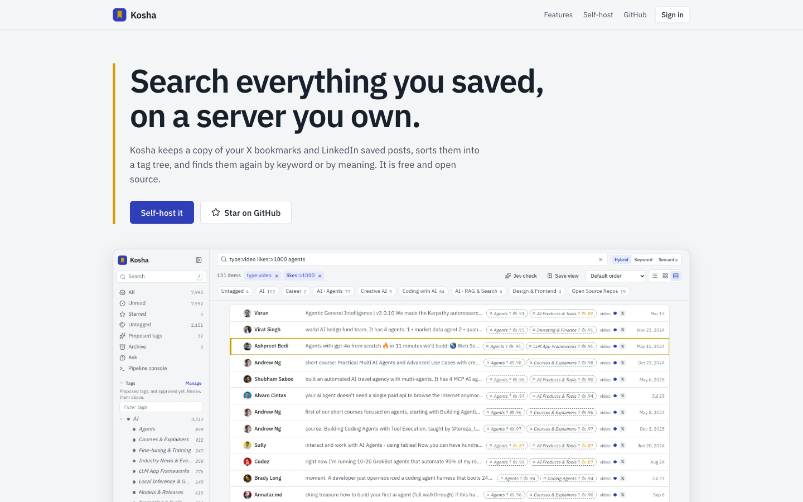
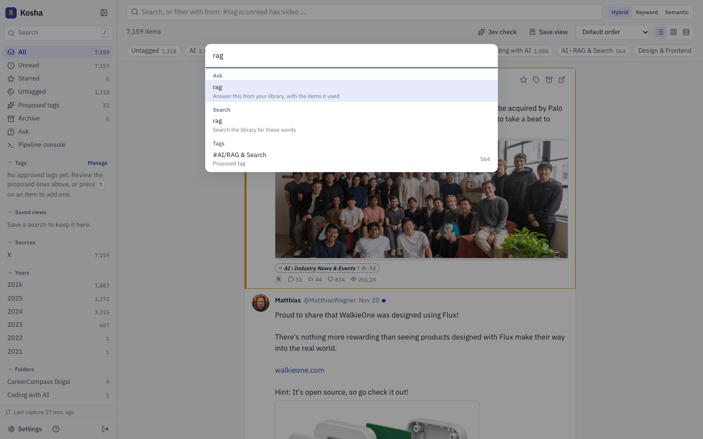
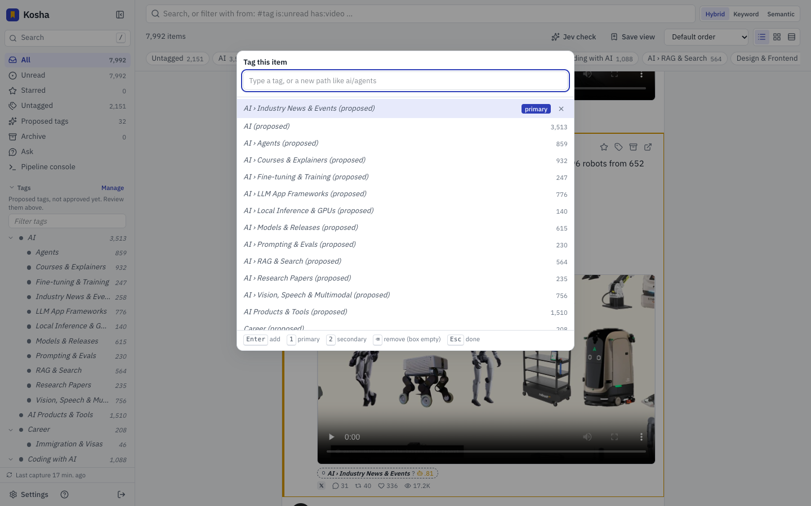
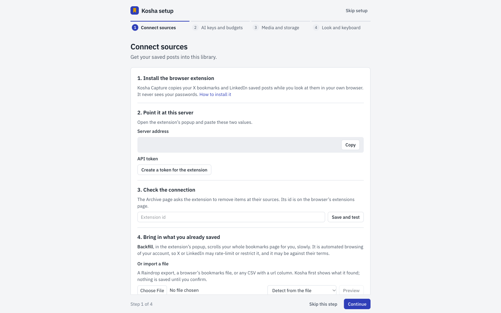
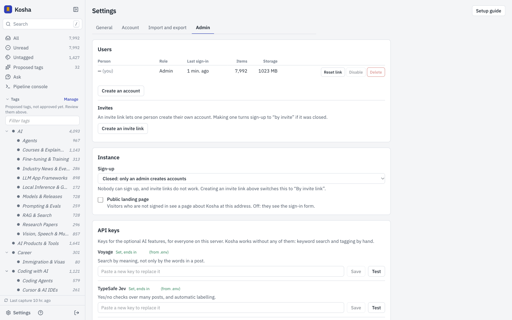

# Kosha

Kosha is a self-hosted library for the things you save: X bookmarks and LinkedIn saved posts today, any web page through its API. It keeps a copy of each item on your own server, lets you organise them in a tag tree, and searches them by keyword and by meaning. An MCP server gives an agent the same search, tagging and question-answering tools that the web app uses.



Each person on a server has their own library. It is under construction: it works on a library of about 8,000 items, but it has had one user.

## Screenshots

| | |
|---|---|
|  The library, list view |  Grid view |
|  Search with qualifiers, compact rows |  Reader drawer |
|  Ask: an answer with the items it cites |  Reviewing proposed tags |
|  Command palette |  Tag picker |
|  Setup guide |  Admin: users, sign-up, API keys |

## Features

- **Capture.** A Chrome extension copies your X bookmarks and LinkedIn saved posts to the server while you browse them. The server parses the raw data, so a change at the source is fixed without capturing again.
- **Import and export.** Import a browser bookmarks file, a Raindrop export or any CSV with a `url` column. Export everything, or any search, as CSV, bookmarks HTML or JSON.
- **Stored media.** Photos and video previews are kept on the server's disk or in an S3-compatible bucket. Storing whole videos is optional.
- **Accounts.** The first person creates the admin account. Others join by invite, or freely if the admin opens sign-up.
- **Search.** One search bar with qualifiers (`from:`, `#tag`, `type:video`, `saved:2026-03..`, `likes:>100`, `is:untagged` and more), in three modes: keyword, semantic, and both fused.
- **Tags.** A tag tree with primary and secondary tags per item. Tags an agent proposes stay "proposed" until you approve or reject them, one by one or a whole subtree at once.
- **Lists and saved views.** Hand-ordered lists of items, and searches saved by name.
- **Ask.** A question in plain language, answered from the library with the cited items shown as cards. It shows the searches it ran, the time and the cost.
- **Pipelines.** A small query language (`where … | hybrid "…" | jev "…" | count by author`) for filtering, ranking, judging with a yes/no classifier, counting and bulk writes. Writes over 25 items return a preview first, and every write can be undone.
- **Media text.** Transcripts for video and audio and descriptions for images, so search can find what is said and shown. The count, the minutes and the cost are shown before anything runs.
- **Keyboard.** Every action has a key, and the keys can be remapped. `?` lists them.
- **Archive and removal.** Archiving an item marks it for removal; the extension can then remove it at the source.
- **Spending caps.** Every paid call is recorded. There is a monthly cap for the X API, for the classifier and for LLM calls.
- **MCP server.** Six tools (`query`, `tags`, `edit_item`, `add_item`, `jobs`, `runs`) at `/mcp`.

## Architecture

```
Chrome extension ──raw captures──▶ ┌──────────────────────────┐
(X and LinkedIn pages)             │ Backend (FastAPI)        │ ──▶ Postgres
                                   │  parse, store, search    │     (pgvector, pg_trgm, ltree)
Web app (React) ──── /api ───────▶ │  pipelines, Ask, jobs    │ ──▶ media files (disk or S3)
MCP client ───────── /mcp ───────▶ │                          │ ──▶ optional paid APIs
                                   └──────────────────────────┘     (embeddings, classifier, LLM, X API)
```

- `backend/`: Python 3.12, FastAPI, SQLAlchemy, Alembic. One process serves the API, the MCP endpoint and the built web app.
- `web/`: React, TypeScript, Vite, Tailwind.
- `extension/`: a Chrome extension (Manifest V3), TypeScript.
- `docs/`: [design](docs/DESIGN.md), [search design](docs/SEARCH_DESIGN.md), [capture contract](docs/CAPTURE_CONTRACT.md), [MCP](docs/MCP.md), [running a demo](docs/DEMO.md).

## Accounts

- **The first account.** On a new server the first person to open the web app gets a setup screen and creates the admin account there. To skip that screen, set `KOSHA_ADMIN_EMAIL` and `KOSHA_ADMIN_PASSWORD` in `.env`: that admin is then created (or updated) from them. Set them when others can reach the address before you do.
- **Sign-up modes.** The admin chooses one in Settings → Admin → Instance: *closed* (only an admin creates accounts; the default), *by invite link*, or *open* (anyone who reaches the server can sign up).
- **Invites.** An invite link lets one person create their own account. It works once and expires after 7 days by default. Creating one while sign-up is closed switches it to "by invite"; revoking invites does not switch it back.
- **Admin.** An admin creates, disables and deletes accounts, makes password-reset links (there is no email), sets the API keys for everyone, and chooses where media is stored. Each person's items, tags, lists, settings and API tokens are their own.

## Setup guide

After the first sign-in a short guide asks four things, each of which can be skipped and changed later in Settings: connect sources (the extension, an import file), AI keys and budgets (admin only), media and storage, and look and keyboard. Settings has a "Setup guide" button to go through it again.

## Media storage

Media is stored under `KOSHA_MEDIA_DIR` on the server's disk by default. It can instead go to any S3-compatible store (AWS S3, Cloudflare R2, Backblaze B2, Hetzner, Garage, MinIO, SeaweedFS). Set the `KOSHA_S3_*` variables in `.env`, or let an admin change it in Settings → Admin → Storage, which also tests the connection and copies existing files across. The bucket can stay private (the app streams the files) or serve them through short-lived addresses.

## Media text

Transcripts for video and audio, and descriptions for images. With a DeepInfra key set, transcripts use Whisper large-v3-turbo there by default; without one they use OpenAI. A speech filter runs on the server first, so recordings without speech are not sent. You see the number of files, the minutes and the cost before a run starts. The measurements behind these choices are in [transcription_2026-11-21](docs/experiments/transcription_2026-11-21.md).

## Import and export

- **Import** (Settings → Import and export): a bookmarks HTML file (browsers, Raindrop, Pocket), a Raindrop CSV, or any CSV with a `url` column. Kosha shows what it found first; nothing is saved until you confirm. Duplicates are skipped, and the pages are not fetched.
- **Export**: everything, or only what a search finds, as CSV, bookmarks HTML or JSON. CSV and HTML open in other bookmark tools; JSON holds every field. "Export the current search" in the command palette fills in the search you are looking at.

## Demo mode

A demo is a separate instance with its own database, one published account and a nightly reset. Sign-up, tokens, captures, paid AI calls, permanent delete and the admin pages are refused there. [docs/DEMO.md](docs/DEMO.md) says how to build and run one. Set `KOSHA_DEMO_URL` on your main instance to link the demo from the landing page.

## Quick start

You need Postgres 17 with the `vector` (pgvector), `pg_trgm` and `ltree` extensions available, [`uv`](https://docs.astral.sh/uv/), Node with [`pnpm`](https://pnpm.io/), and Chrome 111 or later. `ffmpeg` is needed only for video transcripts.

1. **Database.** Create a database named `kosha`. The `pgvector/pgvector:pg17` Docker image has all three extensions.

2. **Environment.** Create `.env` in the repository root. It is never committed.

   | Variable | Purpose |
   |---|---|
   | `DATABASE_URL` | The Postgres URL, with the `postgresql+psycopg://` scheme |
   | `KOSHA_SECRET_KEY` | Signs the session cookie and encrypts API keys saved in the app |
   | `KOSHA_ADMIN_EMAIL`, `KOSHA_ADMIN_PASSWORD` | Optional. The admin account; without them the first visitor creates it on the setup screen |
   | `KOSHA_API_TOKEN` | Optional. The admin's bearer token for the extension and MCP clients; tokens can also be made in Settings |
   | `KOSHA_COOKIE_SECURE` | Set `false` when you use plain http on your own machine |
   | `KOSHA_MEDIA_DIR` | Optional. Where media is stored on disk |
   | `VOYAGE_API_KEY` | Optional. Embeddings for semantic search; without it search is keyword-only |
   | `TYPESAFE_API_KEY` | Optional. The Jev yes/no classifier used by pipelines |
   | `OPENAI_API_KEY` | Optional. Ask, image descriptions, and transcripts when no DeepInfra key is set |
   | `DEEPINFRA_API_KEY` | Optional. Transcripts with Whisper large-v3-turbo |
   | `KOSHA_LANDING` | Optional. `true` shows the landing page to signed-out visitors |
   | `KOSHA_X_ACCESS_TOKEN`, `KOSHA_X_USER_ID` | Optional. The official X API bookmark sync |

   The full list is in [backend/README.md](backend/README.md), and [.env.example](.env.example) has every variable with a comment. An admin can also save the API keys in Settings → Admin.

3. **Backend.**

   ```sh
   cd backend
   uv sync
   uv run kosha migrate        # create the schema
   uv run kosha create-admin   # optional: the admin account and the API token, from .env
   ```

4. **Web app.**

   ```sh
   cd web
   pnpm install
   pnpm build                  # writes web/dist, which the backend serves
   ```

5. **Serve.**

   ```sh
   cd backend
   uv run kosha serve          # http://127.0.0.1:8000
   ```

   Open `http://127.0.0.1:8000` and sign in, or create the admin account on the setup screen. For work on the web app, run `pnpm dev` in `web/` instead and open `http://localhost:5173`.

6. **Extension.**

   ```sh
   cd extension
   pnpm install
   pnpm build
   ```

   In `chrome://extensions`, turn on Developer mode, press "Load unpacked" and choose `extension/dist`. Open the extension's popup, enter the server URL and the API token, and press "Test connection". Details are in [extension/README.md](extension/README.md).

7. **After the first captures.** `uv run kosha summarize`, then `uv run kosha embed` (paid, needs `VOYAGE_API_KEY`) to make semantic search work.

8. **MCP client.** With the server running:

   ```sh
   claude mcp add --transport http kosha http://127.0.0.1:8000/mcp --header "Authorization: Bearer $KOSHA_API_TOKEN"
   ```

   The tools and the pipeline grammar are in [docs/MCP.md](docs/MCP.md).

## Run with Docker

The quickest way to try Kosha: Docker with Compose is all you need. It runs two containers, Postgres with pgvector and the app (the API, the MCP endpoint and the built web app).

```sh
git clone <this repository> kosha && cd kosha
cp .env.example .env        # set KOSHA_SECRET_KEY (KOSHA_ADMIN_EMAIL and KOSHA_ADMIN_PASSWORD are optional)
docker compose up -d        # the first build takes a minute or two
```

Open `http://localhost:8080`. With `KOSHA_ADMIN_EMAIL` and `KOSHA_ADMIN_PASSWORD` set in `.env`, sign in with them: the account is created on every start, so changing the password in `.env` and running `docker compose up -d` again updates it. Without them, the first visitor gets the setup screen and creates the admin account there. The schema is created on every start. No API key is needed: without them search is keyword-only, and Ask, Jev and media text are unavailable (`.env.example` says which key turns on what).

```sh
docker compose logs -f app                 # the server log
docker compose exec app kosha summarize    # any `kosha` command (see backend/README.md)
docker compose up -d --build               # after pulling new code
docker compose down                        # stop; the data stays
docker compose down -v                     # stop and delete the database and the media
```

- The data lives in two named volumes: `kosha_pgdata` (the database) and `kosha_media` (stored media).
- The app listens on this machine only (`127.0.0.1:8080`); set `KOSHA_PORT` in `.env` for another port. To reach it from elsewhere, put a reverse proxy with HTTPS in front and set `KOSHA_COOKIE_SECURE=true` ([deploy/](deploy/README.md) has an nginx example).
- For the extension and MCP clients, the server URL is `http://localhost:8080` and the token is `KOSHA_API_TOKEN` from `.env`.

## How capture works, and its risks

The extension runs in your own browser, in your own signed-in session. On X it records the bookmark responses that X already sends to your browser when you open your bookmarks. On LinkedIn it reads the saved-posts page as it is shown to you. A backfill scrolls those pages for you, slowly, with pauses. Removal presses the same "remove bookmark" and "unsave" buttons that you would. The extension never sees your passwords, and it sends data only to the Kosha server you configure.

Know these before you use it:

- **This may be against the terms of X and LinkedIn.** Both restrict automated access and scraping, even of your own account's pages. You use this at your own risk.
- **Your account may be limited or restricted.** LinkedIn restricts accounts for automated activity and does not publish its limits. X may rate-limit or challenge an account during a long backfill. The extension is paced slowly and stops at a sign-in page, a captcha or an unexpected dialog. That lowers the risk; it does not remove it.
- **Removal cannot be undone.** A bookmark or saved post removed at the source is gone there. Removal changes your account, so it is the riskier of the two.
- **The sites change.** When they do, capture may find nothing or removal may fail, until the extension or the parser is updated.
- **The API token is stored unencrypted** in the extension's local storage.
- **The library holds other people's posts.** Keep your server private.

The official X API sync is a separate, optional path. It is paid, off by default, and has its own monthly cap.

## Experiments

Each write-up in `docs/experiments/` records one measurement on a real library. None reproduces bookmark text.

- [search_eval](docs/experiments/search_eval_2026-11-21.md): 20 test queries against the first build of search, with results, latency and the main weaknesses.
- [pipeline_smoke](docs/experiments/pipeline_smoke_2026-11-21.md): what the pipeline engine returned, how long it took and what it cost, through the API and MCP.
- [ask_eval](docs/experiments/ask_eval_2026-11-21.md): Ask on the same 20 queries with two models: answers, steps, time and cost.
- [labeling](docs/experiments/labeling_2026-11-21.md): five ways for an agent to build a tag tree and label the library, compared against an LLM reference ([the 200 reference items](docs/experiments/labeling_reference_200.json)).
- [summaries](docs/experiments/summaries_2026-11-21.md): five summary recipes compared; rule-built summaries stay the default and LLM summaries are not written.
- [media_text](docs/experiments/media_text_2026-11-21.md): transcripts and image descriptions on 14 real media files: quality, cost and the size of a full run.
- [transcription](docs/experiments/transcription_2026-11-21.md): DeepInfra Whisper turbo against OpenAI on 20 clips, and the speech filter that runs first.

## Credits

The X capture hook in the extension and parts of the X parser and media code in the backend are ported from or modelled on [twitter-web-exporter](https://github.com/prinsss/twitter-web-exporter) by prinsss, used under the MIT License. See [extension/NOTICE](extension/NOTICE) and [backend/NOTICE](backend/NOTICE).

## Licence

MIT. See [LICENSE](LICENSE).
