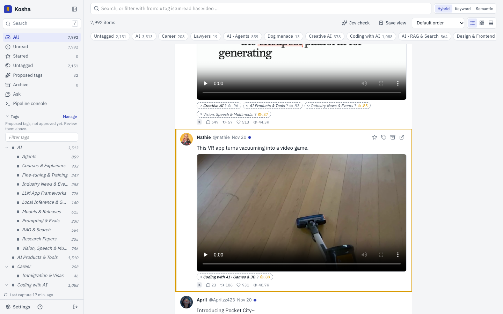
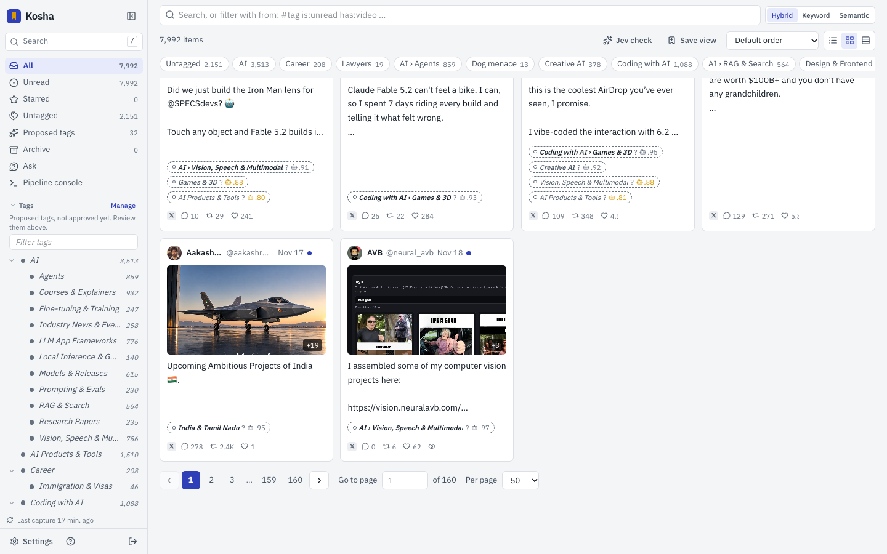
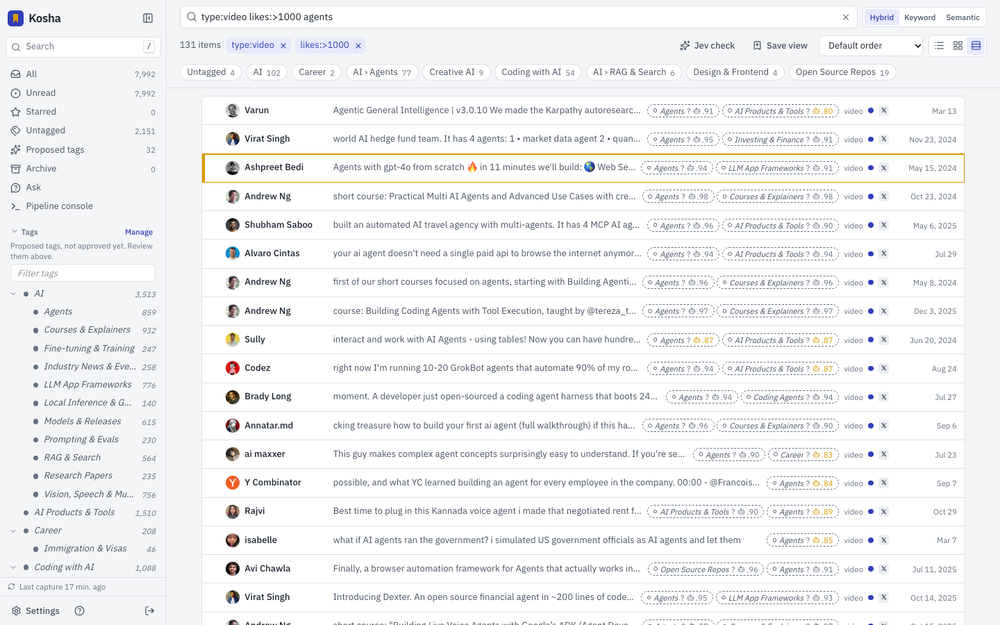
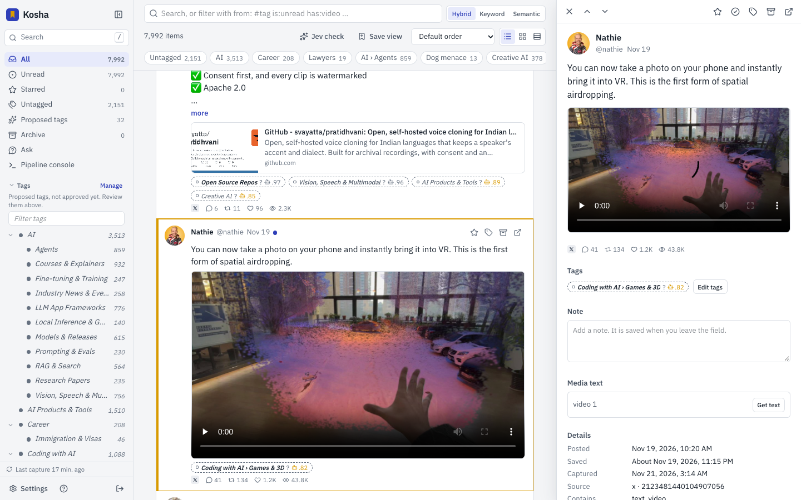
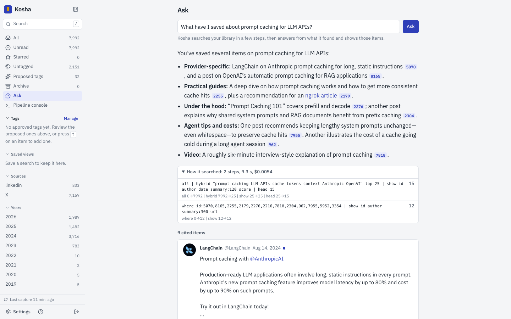
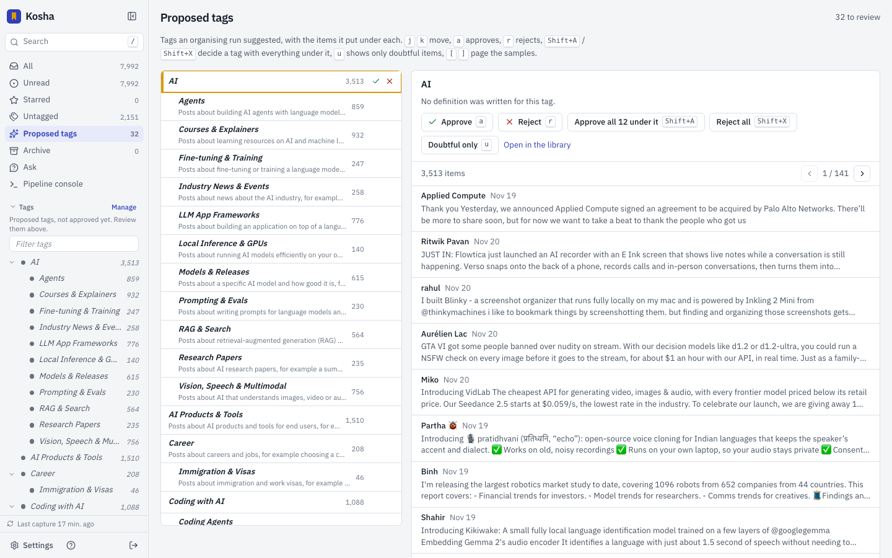

# Kosha

Kosha is a self-hosted library for the things you save: X bookmarks and LinkedIn saved posts today, any web page through its API. It keeps a copy of each item on your own server, lets you organise them in a tag tree, and searches them by keyword and by meaning. An MCP server gives an agent the same search, tagging and question-answering tools that the web app uses.

It is built for one person and one account. It is under construction: it works on a library of about 8,000 items, but it has had one user.

## Screenshots

| | |
|---|---|
|  The library, list view |  Grid view |
|  Search with qualifiers, compact rows |  Reader drawer |
|  Ask: an answer with the items it cites |  Reviewing proposed tags |
|  Command palette |  Tag picker |

## Features

- **Capture.** A Chrome extension copies your X bookmarks and LinkedIn saved posts to the server while you browse them. The server parses the raw data, so a change at the source is fixed without capturing again.
- **Stored media.** Photos and video previews are kept locally. Storing whole videos is optional.
- **Search.** One search bar with qualifiers (`from:`, `#tag`, `type:video`, `saved:2026-03..`, `likes:>100`, `is:untagged` and more), in three modes: keyword, semantic, and both fused.
- **Tags.** A tag tree with primary and secondary tags per item. Tags an agent proposes stay "proposed" until you approve or reject them, one by one or a whole subtree at once.
- **Lists and saved views.** Hand-ordered lists of items, and searches saved by name.
- **Ask.** A question in plain language, answered from the library with the cited items shown as cards. It shows the searches it ran, the time and the cost.
- **Pipelines.** A small query language (`where … | hybrid "…" | jev "…" | count by author`) for filtering, ranking, judging with a yes/no classifier, counting and bulk writes. Writes over 25 items return a preview first, and every write can be undone.
- **Media text.** Transcripts for video and audio and descriptions for images, so search can find what is said and shown. The count, the minutes and the cost are shown before anything runs.
- **Keyboard.** Every action has a key, and the keys can be remapped. `?` lists them.
- **Archive and removal.** Archiving an item marks it for removal; the extension can then remove it at the source.
- **Spending caps.** Every paid call is recorded. There is a monthly cap for the X API, for the classifier and for LLM calls.
- **MCP server.** Six tools (`query`, `tags`, `edit_item`, `add_item`, `jobs`, `runs`) at `/mcp`.

## Architecture

```
Chrome extension ──raw captures──▶ ┌──────────────────────────┐
(X and LinkedIn pages)             │ Backend (FastAPI)        │ ──▶ Postgres
                                   │  parse, store, search    │     (pgvector, pg_trgm, ltree)
Web app (React) ──── /api ───────▶ │  pipelines, Ask, jobs    │ ──▶ media files on disk
MCP client ───────── /mcp ───────▶ │                          │ ──▶ optional paid APIs
                                   └──────────────────────────┘     (embeddings, classifier, LLM, X API)
```

- `backend/`: Python 3.12, FastAPI, SQLAlchemy, Alembic. One process serves the API, the MCP endpoint and the built web app.
- `web/`: React, TypeScript, Vite, Tailwind.
- `extension/`: a Chrome extension (Manifest V3), TypeScript.
- `docs/`: [design](docs/DESIGN.md), [search design](docs/SEARCH_DESIGN.md), [capture contract](docs/CAPTURE_CONTRACT.md), [MCP](docs/MCP.md).

## Quick start

You need Postgres 17 with the `vector` (pgvector), `pg_trgm` and `ltree` extensions available, [`uv`](https://docs.astral.sh/uv/), Node with [`pnpm`](https://pnpm.io/), and Chrome 111 or later. `ffmpeg` is needed only for video transcripts.

1. **Database.** Create a database named `kosha`. The `pgvector/pgvector:pg17` Docker image has all three extensions.

2. **Environment.** Create `.env` in the repository root. It is never committed.

   | Variable | Purpose |
   |---|---|
   | `DATABASE_URL` | The Postgres URL, with the `postgresql+psycopg://` scheme |
   | `KOSHA_SECRET_KEY` | Signs the session cookie |
   | `KOSHA_ADMIN_EMAIL`, `KOSHA_ADMIN_PASSWORD` | The single account |
   | `KOSHA_API_TOKEN` | Bearer token for the extension and MCP clients |
   | `KOSHA_COOKIE_SECURE` | Set `false` when you use plain http on your own machine |
   | `KOSHA_MEDIA_DIR` | Optional. Where media is stored |
   | `VOYAGE_API_KEY` | Optional. Embeddings for semantic search; without it search is keyword-only |
   | `TYPESAFE_API_KEY` | Optional. The Jev yes/no classifier used by pipelines |
   | `OPENAI_API_KEY` | Optional. Ask, transcripts and image descriptions |
   | `KOSHA_X_ACCESS_TOKEN`, `KOSHA_X_USER_ID` | Optional. The official X API bookmark sync |

   The full list is in [backend/README.md](backend/README.md).

3. **Backend.**

   ```sh
   cd backend
   uv sync
   uv run kosha migrate        # create the schema
   uv run kosha create-admin   # the account and the API token, from .env
   ```

4. **Web app.**

   ```sh
   cd web
   pnpm install
   pnpm build                  # writes web/dist, which the backend serves
   ```

5. **Serve.**

   ```sh
   cd backend
   uv run kosha serve          # http://127.0.0.1:8000
   ```

   Open `http://127.0.0.1:8000` and sign in. For work on the web app, run `pnpm dev` in `web/` instead and open `http://localhost:5173`.

6. **Extension.**

   ```sh
   cd extension
   pnpm install
   pnpm build
   ```

   In `chrome://extensions`, turn on Developer mode, press "Load unpacked" and choose `extension/dist`. Open the extension's popup, enter the server URL and the API token, and press "Test connection". Details are in [extension/README.md](extension/README.md).

7. **After the first captures.** `uv run kosha summarize`, then `uv run kosha embed` (paid, needs `VOYAGE_API_KEY`) to make semantic search work.

8. **MCP client.** With the server running:

   ```sh
   claude mcp add --transport http kosha http://127.0.0.1:8000/mcp --header "Authorization: Bearer $KOSHA_API_TOKEN"
   ```

   The tools and the pipeline grammar are in [docs/MCP.md](docs/MCP.md).

There is a `docker-compose.yml`, but it has not been tested.

## How capture works, and its risks

The extension runs in your own browser, in your own signed-in session. On X it records the bookmark responses that X already sends to your browser when you open your bookmarks. On LinkedIn it reads the saved-posts page as it is shown to you. A backfill scrolls those pages for you, slowly, with pauses. Removal presses the same "remove bookmark" and "unsave" buttons that you would. The extension never sees your passwords, and it sends data only to the Kosha server you configure.

Know these before you use it:

- **This may be against the terms of X and LinkedIn.** Both restrict automated access and scraping, even of your own account's pages. You use this at your own risk.
- **Your account may be limited or restricted.** LinkedIn restricts accounts for automated activity and does not publish its limits. X may rate-limit or challenge an account during a long backfill. The extension is paced slowly and stops at a sign-in page, a captcha or an unexpected dialog. That lowers the risk; it does not remove it.
- **Removal cannot be undone.** A bookmark or saved post removed at the source is gone there. Removal changes your account, so it is the riskier of the two.
- **The sites change.** When they do, capture may find nothing or removal may fail, until the extension or the parser is updated.
- **The API token is stored unencrypted** in the extension's local storage.
- **The library holds other people's posts.** Keep your server private.

The official X API sync is a separate, optional path. It is paid, off by default, and has its own monthly cap.

## Experiments

Each write-up in `docs/experiments/` records one measurement on a real library. None reproduces bookmark text.

- [search_eval](docs/experiments/search_eval_2026-11-21.md): 20 test queries against the first build of search, with results, latency and the main weaknesses.
- [pipeline_smoke](docs/experiments/pipeline_smoke_2026-11-21.md): what the pipeline engine returned, how long it took and what it cost, through the API and MCP.
- [ask_eval](docs/experiments/ask_eval_2026-11-21.md): Ask on the same 20 queries with two models: answers, steps, time and cost.
- [labeling](docs/experiments/labeling_2026-11-21.md): five ways for an agent to build a tag tree and label the library, compared against an LLM reference ([the 200 reference items](docs/experiments/labeling_reference_200.json)).
- [summaries](docs/experiments/summaries_2026-11-21.md): five summary recipes compared; rule-built summaries stay the default and LLM summaries are not written.
- [media_text](docs/experiments/media_text_2026-11-21.md): transcripts and image descriptions on 14 real media files: quality, cost and the size of a full run.

## Credits

The X capture hook in the extension and parts of the X parser and media code in the backend are ported from or modelled on [twitter-web-exporter](https://github.com/prinsss/twitter-web-exporter) by prinsss, used under the MIT License. See [extension/NOTICE](extension/NOTICE) and [backend/NOTICE](backend/NOTICE).

## Licence

MIT. See [LICENSE](LICENSE).
